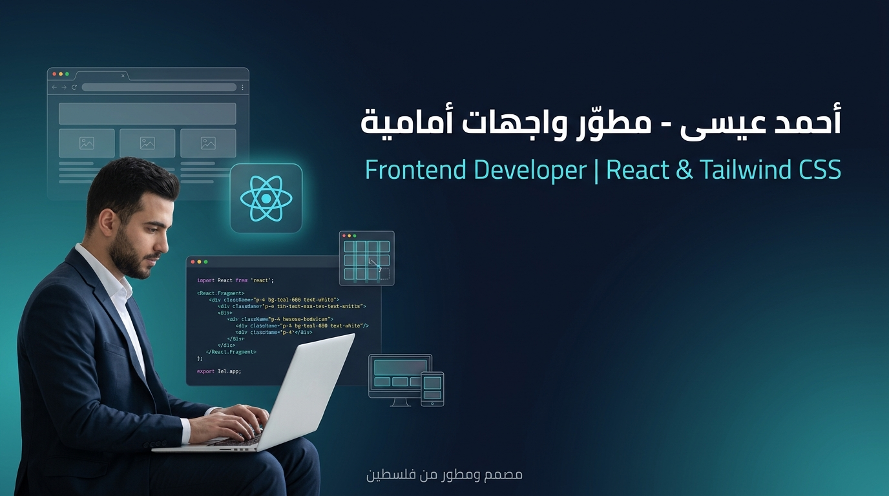
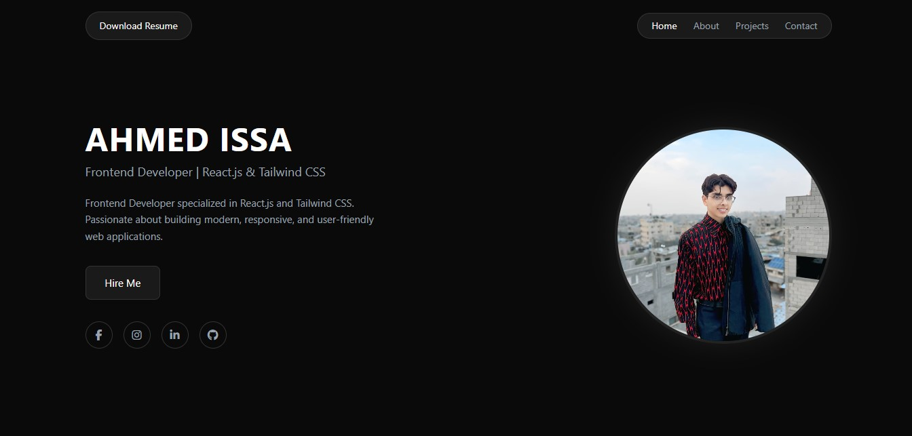

<p align="center">
  
</p>

# 👨‍💻 Ahmed Issa | Portfolio

A modern, fully responsive personal portfolio website showcasing my projects and skills as a Frontend Developer. Built with React, Tailwind CSS, and Vite.

🔗 **Live Demo:** [dev-ahmedissa.github.io/ahmed-issa-portfolio](https://dev-ahmedissa.github.io/ahmed-issa-portfolio/)

## 📸 Preview



## ✨ Features

- Fully responsive layout that adapts to mobile, tablet, and desktop screens
- Modern, clean design built with Tailwind CSS
- Fast development and build with Vite
- Component-based structure with React
- Showcase of my projects with links to live demos and source code
- Contact information for freelance and remote opportunities

## 🛠️ Built With

- React
- Tailwind CSS
- Vite
- JavaScript

## 🚀 Run Locally

```bash
git clone https://github.com/dev-ahmedissa/ahmed-issa-portfolio.git
cd ahmed-issa-portfolio
npm install
npm run dev
```

Then open the local URL shown in your terminal (usually `http://localhost:5173`).

## 📦 Build

```bash
npm run build
```

## 📬 Contact

**Ahmed Issa**, Frontend Developer
[ahmednashatissa@gmail.com](mailto:ahmednashatissa@gmail.com) • [GitHub](https://github.com/dev-ahmedissa)
